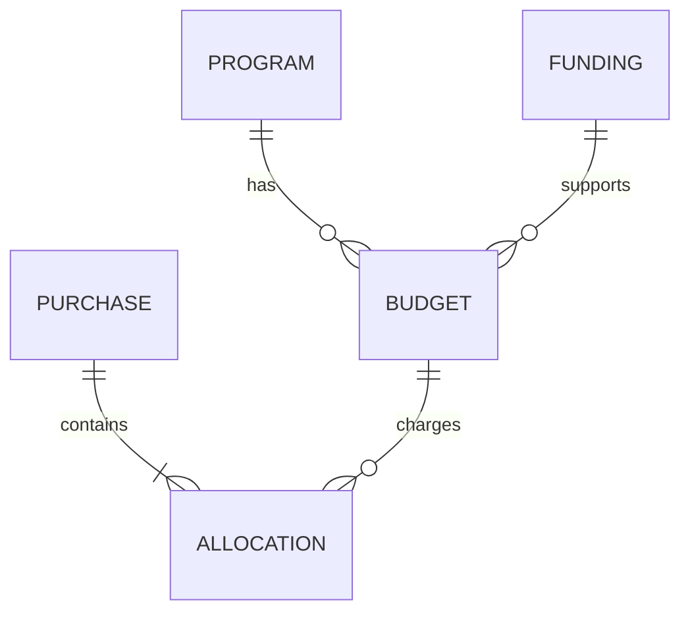

# Architecture and requirements
React UI -> FastAPI routes -> financial service -> PostgreSQL.
Staff-only access; no student records. Initial MVP uses one configured staff credential, HTTP Basic on localhost only; production requires TLS, individual account lifecycle, sessions and security review.
Funding receipts distinguish expected from received; cash and credits separate. Program budgets are allocations, not expenses. A purchase has one or more program/funding allocations. All allocations must equal purchase total. Confirmed funding only, valid dates, eligible program and supplier, sufficient balances. Default funding priorities and AI suggestions are future work; staff confirms splits.
Academic year identifiers isolate records. Carry-forward, corrections, audit trail expansion, Excel import/export and receipt handling are later phases. No real data in public repo.

Open decisions: actual spreadsheet format, funding restrictions, year dates, overspending policy, staff handover, AI provider approval. Initial prototype blocks overspending and requires explicit budget allocation.
