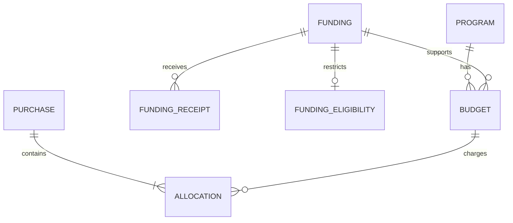

# Architecture and requirements

The React staff interface calls same-origin FastAPI routes through Caddy in HTTPS deployments. FastAPI uses Psycopg and parameterized PostgreSQL queries. One designated staff account uses salted scrypt credentials and opaque server-side sessions. The production profile requires secure cookies and keeps the API service off the public network. The public Pages build uses a fictional in-memory transport.

Funding receipts distinguish confirmed funds from expected awards. Cash and purchasing credits have separate balances. A budget reserves confirmed funding for a program. Purchase allocations must add up to the purchase total in integer cents. The server checks the program, supplier, purchase type, remaining balances, expiry, and academic year for each allocation. Allocation suggestions apply the same eligibility checks and require staff confirmation.

A source can list multiple eligible values per category. Each nonempty list must match the purchase. Existing single-value restrictions are read when a source has no edited list. The row lock on the source coordinates spending, budget changes, and edits. Grant exceptions that depend on individual items or reporting evidence require staff review. Release an unused incompatible budget to zero before removing that program from the source's rules. Active transfers preserve the source's rules and block changes that would diverge from them.

Academic years isolate funding and budgets. Semester presets and report date filters support reporting within the selected financial year. Corrections link a replacement to the original, and voids preserve history while restoring capacity. Excel import uses the same purchase validation. Reconciliation compares internal records, and bank settlement is a separate staff process.

The eligibility schema is additive. A database backup includes the effective rules and their audit history. If reverting the app from a version with list-based rules, pause writes and verify that the restored version enforces the current rules before reopening staff access. Older servers only interpret the legacy fields.

Formal financial dates, approved grant terms, staff account handover, receipt retention and external AI approval remain stakeholder decisions.
