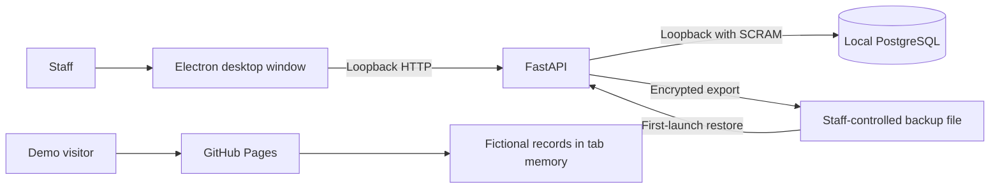
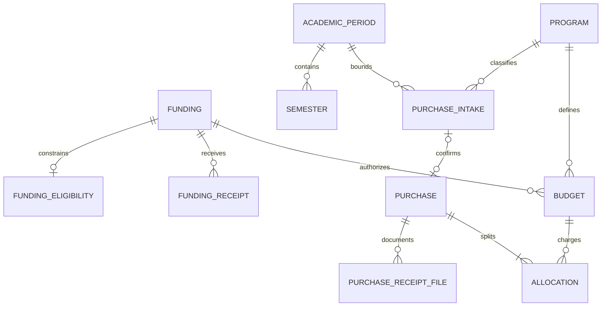
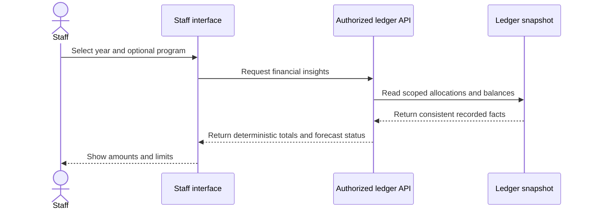
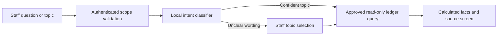

# ASUFC Finance project handover

The Acadia Students’ Union Food Cupboard needed to track several streams of restricted funding, allocate them across programs, and reconcile spending without relying on a single planning balance. The desktop edition is designed for one designated staff computer. The project also maintains a fictional GitHub Pages demo and a private development profile.

## Software requirements

| Area | Implemented behavior | Acceptance evidence |
| --- | --- | --- |
| Funding | Record expected and received amounts, source restrictions, expiry and carry-forward decisions. Keep cash and credits independent. | Funding, carry-forward and reconciliation integration tests |
| Budgets | Create programs and allocate several sources across eligible budgets. Enforce the source and program limits. | Budget, purchase-concurrency and eligibility integration tests |
| Purchases | Review pending historical purchases, assign verified allocations, identify likely duplicates, correct or void with an audit trail. | Application integration tests and packaged-runtime starter and purchase checks |
| Receipts | Attach and download private PDF, JPEG and PNG files. Identify byte-for-byte duplicates and link replacements. | Packaged-runtime authorization, invalid file, duplicate, history and recovery checks |
| Reporting | Filter confirmed spending by year, semester, custom date range and ledger dimensions. Export workbooks and compare internal balances. | Report and Excel tests, staff browser flow and packaged-runtime reconciliation |
| Analysis | Show deterministic, year-scoped spending, prior-month totals, budget use, age of funding and cautious spending estimates. | Packaged-runtime amount and program isolation check, forecast unit tests |
| Recovery | Export an encrypted snapshot and restore it into a fresh local ledger. | Packaged-runtime checks for restart, wrong passphrase, truncation, restore and receipt persistence |
| Distribution | Bundle the interface, API and database for Windows x64, macOS Intel and Apple Silicon, and Linux x64. | Offline staff runtime matrix and installed or extracted artifact checks |

## Use case flows

**Record a purchase.** Staff opens Transactions, enters or reviews the final amount and date, then chooses eligible budget lines. The API validates the allocation and writes the purchase and audit event in one transaction. A failed check leaves the ledger unchanged.

**Change a funding decision.** Staff records the reason for editing the award, expiry, eligibility or carry-forward permission. The API validates the change against the source and its existing commitments. Pending amounts stay separate until staff confirm receipt.

**Recover a ledger.** Staff selects an encrypted backup during first launch on a fresh profile, enters the passphrase and signs in using the saved staff account. The recovery transaction includes funding, academic dates, pending purchases, receipt history, recorded transactions and audit events.

## Deployment and system design

The desktop runtime listens on loopback, uses a restricted renderer, and stores the ledger under the current operating-system user's application data. Backups use passphrase-derived scrypt keys and AES-GCM authentication. Backup and restore preserve data as a consistent snapshot without writing a plaintext archive. Receipt downloads require staff authorization, uploads are bounded, and replacements preserve the original attachment.

## Verification and maintenance

- Follow [offline-desktop.md](offline-desktop.md) for development builds, checklist, platform packaging and signing. Follow [the staff handbook](staff-handbook.md) for daily work and recovery.
- [Financial application checks](https://github.com/JayJPatel223/ASUFC/actions/workflows/ci.yml) run the application, browser, dependency and infrastructure suites. [Offline staff runtime](https://github.com/JayJPatel223/ASUFC/actions/workflows/desktop-runtime.yml) runs the packaged-runtime, window and installation checks. See [PROGRESS.md](../PROGRESS.md) for the handover build's recorded results.
- Use the private starter file on the designated staff computer. GitHub, the demo, CI data, and the university demonstration use fictional records.
- To demonstrate the app, create fictional grant and credit records, split a fictional purchase, attach and replace a sample receipt, export a report, then restore an encrypted backup on a second profile. Confirm that the restored balances and receipt history match.

## Handover decisions

ASUFC owns the staff profile, password custody, backup destination and retention, official financial cutoffs, final grant evidence and item-level eligibility review. The ledger records funding decisions, while staff verify receipts and assign historical purchases. Signed installer distribution and a physically disconnected recovery drill require the designated hardware and publishing credentials.

The assistant uses a small offline text classifier trained on fictional example questions. It maps a question to an approved topic, validates the year and program, and calls the same deterministic calculation used by Financial insights. Staff can choose a supported topic directly when the model cannot match their wording. The model reads the question only. Ledger values are retrieved by the application to build the answer and remain on the computer. Forecasts remain unavailable when there are fewer than six consecutive complete months of recorded spending for the selected scope.

External model access remains subject to institutional approval. A generative model or receipt extraction workflow requires separate evaluation and testing.
